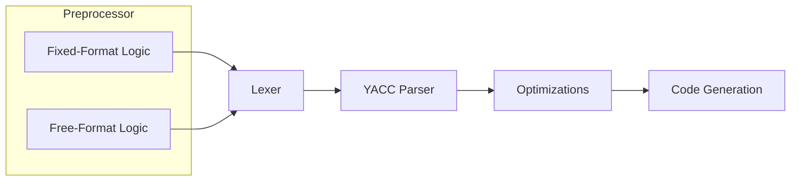

# Language Processing   *Processamento de Linguagens*

## Resources

- [EWVM](https://ewvm.epl.di.uminho.pt/)
- [FORTRAN 77 Reference Language | Oracle](https://docs.oracle.com/cd/E19957-01/805-4939/)
- [FORTRAN 77 Reference Language Manual | Innsbruck](http://physik.uibk.ac.at/hephy/praktikum/fortran_manual.pdf)
- [FORTRAN 77 | Wikipedia](https://en.wikipedia.org/wiki/Fortran_77)
- [FORTRAN 77 Standard Fixed Format | Oracle](https://docs.oracle.com/cd/E19957-01/805-4939/z40007331fe6/index.html)

## TODO list

- [ ] NOTE that strict version was implemented instead of implicit typing rules
- [ ] Out of range errors are detected in the lexer, but they are not complete
      (e.g. MINUS NUMBER, etc.) we could add a semantic check for this after the
      parsing, also adjust values for EWVM compatibility
- [ ] Use `parser.has_error` fields to raise an exception once at the end of
      parsing in the code generation phase
- [ ] Type checking with new AST object
- [ ] Variables (unused warning, redefinition, etc.)
- [ ] Functions check if they exist, right number of arguments, etc. (similarity function for hints)
- [ ] Add more lexer tests
    - [x] strings (escaped delimiter, multiline, etc.)
- [ ] Write equivalent .f90 (free-format) at examples/
- [x] Clean parser rules documentation "AST node: ..."
- [ ] Optimizations
    - [ ] Constant folding
    - [ ] Expression simplification
    - [ ] Unused variable elimination
    - [ ] Constant `IF` elimination
    - [ ] Loop unrolling
- [ ] (parser) check if check for special statements like RETURN, CONTINUE, STOP,
      are being only recognized in the right contexts
      (e.g. RETURN only inside subroutines/functions, etc.)
- [x] test labels errors (e.g. redefinition, use of undefined labels,
      warning for unused labels)

## Compiler Pipeline

## Preprocessing

## Lexical Analysis

## Syntax Analysis

## Semantic Analysis

## Code Generation

## Code Optimization

- Unused variable elimination
- Constant `IF` elimination
- Loop unrolling
