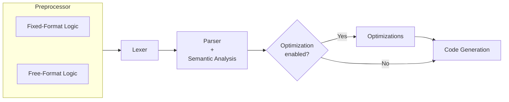

[](https://github.com/migueltc13/project-LP/actions/workflows/tests.yml)

# Language Processing <br/> *Processamento de Linguagens*

**TODO** Small project description mentioning the assignment file, and developed work.

## Table of Contents

**TODO**

## TODO list

- Codegen: SUBROUTINE and FUNCTION:
    - Procedure arguments are currently passed by value.
    - Recursive procedures are not supported.
    - Local procedure variables are stored in generated global slots.
    - Intrinsic procedure code generation is not supported yet.
    - Dynamic array dimensions inside procedures are not supported yet.

- [x] Optimizations
    - [x] Constant folding
    - [x] Expression simplification
    - [x] Dead code elimination
        - [x] Unused variables/functions/subroutines elimination
        - [x] If statements with constant conditions
        - [x] Unreachable code after STOP, RETURN, etc.
    - [x] Vectorization
- [ ] Add support for the functions defined in INTRINSIC_FUNCTIONS at
      [procedures.py](src/semantics/procedures.py),
      Maybe reserved this functions as lexer `keywords`.
      Also see `# TODO remove intrinsics that we don't support` at the same file.
      Update `**` to use `POW` intrinsic function instead of generating a loop
      for exponentiation.
- [ ] `semantics/numbers.py`
    - [ ] Detect division by zero and other similar errors
    - [ ] Out of range errors are detected in the lexer, but they are not complete
          (e.g. MINUS NUMBER, etc.) we could add a semantic check for this after the
          parsing, also adjust values for EWVM compatibility
- [x] Variables (unused warning, redefinition, etc.)
- [x] Write equivalent .f90 (free-format) at examples/
- [x] (parser) check for special statements like RETURN, CONTINUE, STOP,
      are being only recognized in the right contexts
      (e.g. RETURN only inside subroutines/functions, etc.)
- [x] test labels errors (e.g. redefinition, use of undefined labels,
      warning for unused labels)
- [ ] NOTE in report that strict version was implemented instead of implicit typing rules

## Usage

```
usage: generator.py [-o OUTPUT] [-O] [-g] [--format {fixed,free}] [--no-preprocess]
                    [--viz [OUTPUT]] [--no-open] [--show-intrinsics] [-v] [-h]
                    [input_file]

Compile Fortran 77 source code into EWVM assembly.

positional arguments:
  input_file            Fortran source file. If omitted, read from stdin.

options:
  -o OUTPUT, --output OUTPUT
                        Output file. If omitted, output to stdout.
  -O, --optimize        Enable optimizations.
  -g, --debug           Enable debug comments.
  --format {fixed,free}
                        The source format. If omitted, inferred from file extension;
                        stdin defaults to fixed.
  --no-preprocess       Skip preprocessing stage.
  --viz [OUTPUT], --visualize [OUTPUT]
                        Generate a Graphviz image of the AST.
  --no-open             Do not open the generated AST visualization file. Only valid
                        with --viz/--visualize.
  --show-intrinsics     Include intrinsic procedures in verbose semantic info output.
                        Requires -v/--verbose.
  -v, --verbose         Enable verbose output during compilation (e.g. print
                        intermediate AST, semantic info, etc.)
  -h, --help            Show this help message and exit.
```

## Compiler Pipeline

### Overview



### Preprocessor

The compiler pipeline begins with a dedicated **Preprocessor** module. Its
original purpose was to simplify the handling of Fortran 77 fixed-format source
code before lexical analysis. This was necessary because fixed-format Fortran is
highly column-sensitive: columns 1 to 5 may contain a statement label, column 6
is reserved for continuation markers, and the actual statement body begins at
column 7 and may only extend up to column 72.

Handling these rules directly in the lexer would make the lexical analysis
significantly more complex, since the lexer would need to be aware not only of
tokens, but also of their exact column positions. To avoid this, the
preprocessor converts fixed-format input into a normalized pseudo-Fortran
representation that is easier for the lexer to process.

For fixed-format source code, the preprocessor is responsible for:

- enforcing the maximum column width of 72 characters;
- normalizing full-line comments beginning with `C`, `c`, or `*` in column
    into a common `!` comment form;
- extracting labels from columns 1 to 5 and converting them into an explicit
    pseudo-token, such as `@LABEL(100)`;
- validating that labels contain only numeric values with at most five digits;
- detecting continuation lines through column 6, and converting continuation
    markers into a normalized `&` representation by appending `&` to the
    previous statement line;
- detecting invalid continuations, such as a continuation line without a
    preceding statement.

If invalid fixed-format input is detected, the preprocessor raises an explicit
preprocessing error and the compiler pipeline is halted before lexical analysis.
Examples of such errors include lines exceeding 72 columns, invalid labels in
the label field, or orphaned continuation lines.

After the initial implementation, the group realized that the same normalization
strategy could also be applied to free-format source code. Although free-format
does not depend on fixed columns, labels can still appear before statements.
Therefore, the free-format preprocessor also converts labels into the same
`@LABEL(...)` pseudo-token representation. This allows both fixed-format and
free-format programs to be transformed into a common intermediate textual
representation before reaching the lexer.

The result is a single preprocessing stage that supports both source formats and
produces a normalized pseudo-Fortran 77 stream. This reduces the complexity of
the lexer and also the parser, since they no longer need to distinguish between
several surface-level formatting conventions. Instead, they can operate over a
more uniform representation.

However, this approach also introduces an important disadvantage. The
preprocessor inserts pseudo-tokens, such as `@LABEL(...)`, which are not part of
the original Fortran source code. Although this simplifies the lexer and parser,
it creates a challenge for one of the main objectives of the compiler as a
whole: accurate error reporting. Since transformed lines may no longer preserve
the original column positions, errors detected in later stages may refer to
locations in the preprocessed code rather than in the user’s original source
file.

This trade-off was accepted because the problem can be addressed with
source-location mapping. Since the preprocessor preserves a 1:1 mapping
between original and preprocessed lines, the compiler can extend this mapping
with column information. Later stages, such as the lexer, parser, and semantic
analyser, can then translate reported positions back to the original source.
For example, when a line contains an inserted `@LABEL(...)` token, the compiler
can compensate for the introduced offset and report the correct original column.
This allows the compiler to keep the advantages of normalization while still
preserving accurate diagnostics.

Furthermore, although the preprocessor could try to infer the source format
automatically, this was not chosen because fixed-format and free-format code can
be ambiguous. Instead, the compiler uses an explicit CLI flag when provided,
otherwise it infers the format from the file extension: `.f` for fixed-format
and `.f90` for free-format. When reading from standard input without a specified
format, it defaults to fixed-format.

For example:

```fortran
      PROGRAM EXAMPLE
C = 1
      END
```

In fixed-format Fortran, `C = 1` is a comment because `C` appears in column 1.
In free-format Fortran, it may be interpreted as an assignment to variable `C`.
This ambiguity makes explicit or extension-based format selection more
predictable.

The preprocessing stage is additionally validated through the automated test
[tests/formats.py](tests/formats.py), it compares the outputted lexed tokens for
equivalent fixed-format (`.f`) and free-format (`.f90`) source files. When
running the lexer, the `--test` flag is used to remove the column field from
the lexed tokens, since positions naturally differ between the two formats.

### Lexical Analysis

### Syntax Analysis

### Semantic Analysis

### Optimizations

#### Constant Folding

#### Expression Simplification

#### Dead Code Elimination

#### Vectorization

### Code Generation

## Error Handling

### Supported Diagnostics

Severity                            | Type            | Category     | Description                                                       | Hint
---                                 | ---             | ---          | ---                                                               | ---
$\color{Red}\textsf{Error}$         | Preprocessor    | Format       | Line exceeds 72 columns                                           | $\color{White}\textsf{✗}$
$\color{Red}\textsf{Error}$         | Preprocessor    | Continuation | Orphaned continuation line                                        | $\color{White}\textsf{✗}$
$\color{Red}\textsf{Error}$         | Preprocessor    | Label        | Label field contains non-numeric characters or exceeds 5 digits   | $\color{White}\textsf{✗}$
$\color{Red}\textsf{Error}$         | Lexical         | Characters   | Character not valid in Fortran 77                                 | $\color{Green}\textsf{✓}$
$\color{Red}\textsf{Error}$         | Lexical         | Characters   | Character sequence not valid in Fortran 77                        | $\color{Green}\textsf{✓}$
$\color{Red}\textsf{Error}$         | Syntax          | Characters   | Syntax error in token                                             | $\color{White}\textsf{✗}$
$\color{Red}\textsf{Error}$         | Syntax          | EOF          | Unexpected end of file                                            | $\color{Green}\textsf{✓}$
$\color{Red}\textsf{Error}$         | Semantic        | Program      | Multiple main PROGRAM units defined                               | $\color{Green}\textsf{✓}$
$\color{Red}\textsf{Error}$         | Semantic        | Labels       | Label redefined                                                   | $\color{White}\textsf{✗}$
$\color{Red}\textsf{Error}$         | Semantic        | Labels       | Label referenced but not defined                                  | $\color{White}\textsf{✗}$
$\color{Goldenrod}\textsf{Warning}$ | Semantic        | Labels       | Label defined but not referenced                                  | $\color{White}\textsf{✗}$
$\color{Red}\textsf{Error}$         | Semantic        | Labels/Loops | DO loop target label does not label a CONTINUE statement          | $\color{White}\textsf{✗}$
$\color{Red}\textsf{Error}$         | Semantic        | Variables    | Variable already declared                                         | $\color{White}\textsf{✗}$
$\color{Red}\textsf{Error}$         | Semantic        | Variables    | Use of undeclared variable                                        | $\color{White}\textsf{✗}$
$\color{Red}\textsf{Error}$         | Semantic        | Variables    | Assignment to undeclared variable                                 | $\color{White}\textsf{✗}$
$\color{Goldenrod}\textsf{Warning}$ | Semantic        | Variables    | Variable may be used before being initialized                     | $\color{White}\textsf{✗}$
$\color{Goldenrod}\textsf{Warning}$ | Semantic        | Variables    | Variable declared but not used                                    | $\color{White}\textsf{✗}$
$\color{Red}\textsf{Error}$         | Semantic        | Procedures   | Undefined procedure reference                                     | $\color{Green}\textsf{✓}$
$\color{Red}\textsf{Error}$         | Semantic        | Procedures   | Duplicate procedure definition                                    | $\color{White}\textsf{✗}$
$\color{Red}\textsf{Error}$         | Semantic        | Procedures   | Procedure definition conflicts with intrinsic procedure           | $\color{Green}\textsf{✓}$
$\color{Red}\textsf{Error}$         | Semantic        | Procedures   | FUNCTION called as a SUBROUTINE                                   | $\color{Green}\textsf{✓}$
$\color{Red}\textsf{Error}$         | Semantic        | Procedures   | SUBROUTINE called as a FUNCTION                                   | $\color{Green}\textsf{✓}$
$\color{Red}\textsf{Error}$         | Semantic        | Procedures   | Procedure missing expected number of arguments                    | $\color{White}\textsf{✗}$
$\color{Red}\textsf{Error}$         | Semantic        | Procedures   | RETURN statement outside FUNCTION or SUBROUTINE                   | $\color{White}\textsf{✗}$
$\color{Red}\textsf{Error}$         | Semantic        | Types        | IF condition must be of type LOGICAL                              | $\color{White}\textsf{✗}$
$\color{Red}\textsf{Error}$         | Semantic        | Types        | Array dimension must be of type INTEGER                           | $\color{White}\textsf{✗}$
$\color{Red}\textsf{Error}$         | Semantic        | Types        | Array index must be of type INTEGER                               | $\color{White}\textsf{✗}$
$\color{Red}\textsf{Error}$         | Semantic        | Types        | Cannot assign value of type X to type Y variable                  | $\color{White}\textsf{✗}$
$\color{Red}\textsf{Error}$         | Semantic        | Types        | DO loop variable must be of type INTEGER                          | $\color{White}\textsf{✗}$
$\color{Red}\textsf{Error}$         | Semantic        | Types        | DO loop upper/lower bound must be of type INTEGER                 | $\color{White}\textsf{✗}$
$\color{Red}\textsf{Error}$         | Semantic        | Types        | DO loop step must be of type INTEGER                              | $\color{White}\textsf{✗}$
$\color{Red}\textsf{Error}$         | Semantic        | Types        | DO loop step must be a positive INTEGER                           | $\color{White}\textsf{✗}$
$\color{Red}\textsf{Error}$         | Semantic        | Types        | Unary operators ('+' and '-') require numeric operand             | $\color{White}\textsf{✗}$
$\color{Red}\textsf{Error}$         | Semantic        | Types        | NOT requires a LOGICAL operand                                    | $\color{White}\textsf{✗}$
$\color{Red}\textsf{Error}$         | Semantic        | Types        | Left/right arithmetic operand must be numeric                     | $\color{White}\textsf{✗}$
$\color{Red}\textsf{Error}$         | Semantic        | Types        | Relational operands must have compatible types                    | $\color{White}\textsf{✗}$
$\color{Red}\textsf{Error}$         | Semantic        | Types        | Left/right logical operand must be LOGICAL                        | $\color{White}\textsf{✗}$
$\color{Red}\textsf{Error}$         | Code Gen  | Arrays       | Only one-dimensional arrays are supported yet                     | $\color{White}\textsf{✗}$
$\color{Red}\textsf{Error}$         | Code Gen  | Arrays       | Only one-dimensional array references/assignments are supported yet | $\color{White}\textsf{✗}$
$\color{Red}\textsf{Error}$         | Code Gen  | Arrays       | Dynamic array dimensions inside procedures are not supported yet  | $\color{White}\textsf{✗}$
$\color{Red}\textsf{Error}$         | Code Gen  | Program      | Code generation requires a PROGRAM unit                           | $\color{White}\textsf{✗}$
$\color{Red}\textsf{Error}$         | Code Gen  | Statements   | Unsupported statement for EWVM generation                         | $\color{White}\textsf{✗}$
$\color{Red}\textsf{Error}$         | Code Gen  | Expressions  | Unsupported expression for EWVM generation                        | $\color{White}\textsf{✗}$
$\color{Red}\textsf{Error}$         | Code Gen  | Assignments  | Unsupported assignment target                                     | $\color{White}\textsf{✗}$
$\color{Red}\textsf{Error}$         | Code Gen  | Instructions | Unsupported READ target                                           | $\color{White}\textsf{✗}$
$\color{Red}\textsf{Error}$         | Code Gen  | Instructions | Only one-dimensional array READ is supported yet                  | $\color{White}\textsf{✗}$
$\color{Red}\textsf{Error}$         | Code Gen  | Operators    | Unsupported arithmetic/relational/logical/unary operator          | $\color{White}\textsf{✗}$
$\color{Red}\textsf{Error}$         | Code Gen  | Procedures   | Intrinsic procedure is not supported by code generation yet       | $\color{White}\textsf{✗}$
$\color{Red}\textsf{Error}$         | Code Gen  | Procedures   | Not a FUNCTION/SUBROUTINE                                         | $\color{White}\textsf{✗}$

<!--
HTML:
<span style="background:#ffecec;color:#b00020;padding:2px 6px;border-radius:4px;font-weight:bold;">Error</span>
<span style="background:#fff8db;color:#8a6d00;padding:2px 6px;border-radius:4px;font-weight:bold;">Warning</span>
<span style="color:green">✓</span>
<span style="color:red">✗</span>

LaTeX:
$\color{Goldenrod}\textsf{Warning}$
$\color{Red}\textsf{Error}$
$\color{Green}\textsf{✓}$
$\color{Red}\textsf{✗}$
-->

## Testing

## Conclusions and Future Work

## Resources

### Tools

- [PLY (Python Lex-Yacc)](https://www.dabeaz.com/ply/ply.html)
- [EWVM](https://ewvm.epl.di.uminho.pt/)
- [GraphViz](https://graphviz.org/)
- [GFortran](https://gcc.gnu.org/wiki/GFortran)
- [GitHub Actions](https://github.com/features/actions)

### Fortran 77 References

- [Fortran 77 Reference Language Manual, Innsbruck](http://physik.uibk.ac.at/hephy/praktikum/fortran_manual.pdf)
- [Fortran 77 Reference Language, Oracle](https://docs.oracle.com/cd/E19957-01/805-4939/)
- [Fortran 77 Standard Fixed Format, Oracle](https://docs.oracle.com/cd/E19957-01/805-4939/z40007331fe6/index.html)
- [Fortran 77, Wikipedia](https://en.wikipedia.org/wiki/Fortran_77)

<a href="https://www.youtube.com/watch?v=4XF_Agllu7Q" target="_blank">🥚</a>
