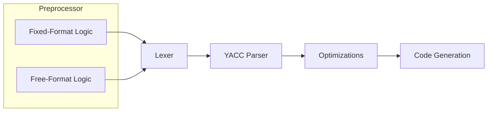

# Language Processing   *Processamento de Linguagens*

## Resources

- [EWVM](https://ewvm.epl.di.uminho.pt/)
- [FORTRAN 77 Reference Language | Oracle](https://docs.oracle.com/cd/E19957-01/805-4939/)
- [FORTRAN 77 Reference Language Manual | Innsbruck](http://physik.uibk.ac.at/hephy/praktikum/fortran_manual.pdf)
- [FORTRAN 77 | Wikipedia](https://en.wikipedia.org/wiki/Fortran_77)
- [FORTRAN 77 Standard Fixed Format | Oracle](https://docs.oracle.com/cd/E19957-01/805-4939/z40007331fe6/index.html)

## TODO list

- [ ] Use states in lexer to catch more errors
    (rationale: maximize lexer work, e.g. PROGRAM, FUNCTION, EXPR, etc.)
- [ ] Add lexer tests
    - [ ] strings (escaped delimiter, multiline, etc.)
- [ ] Write equivalent .f90 (free-format) at examples/

## Compiler Pipeline

## Preprocessing

## Lexical Analysis

## Syntax Analysis

## Semantic Analysis

## Code Translation

## Code Optimization

- Unused variable elimination
- Constant `IF` elimination
- Loop unrolling
