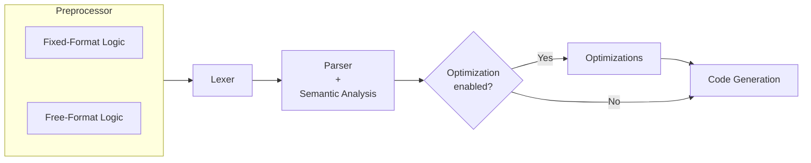
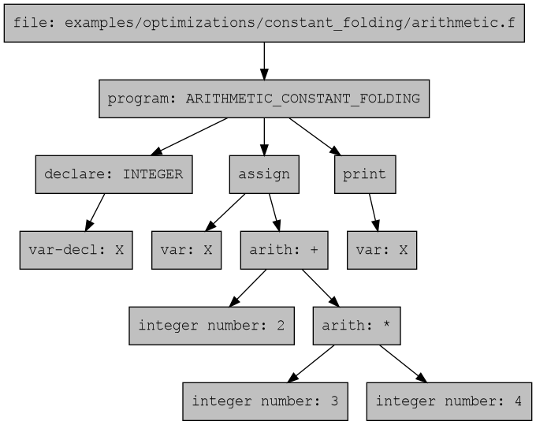
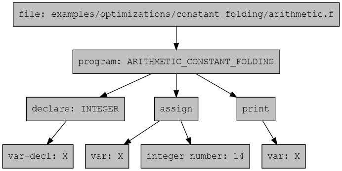
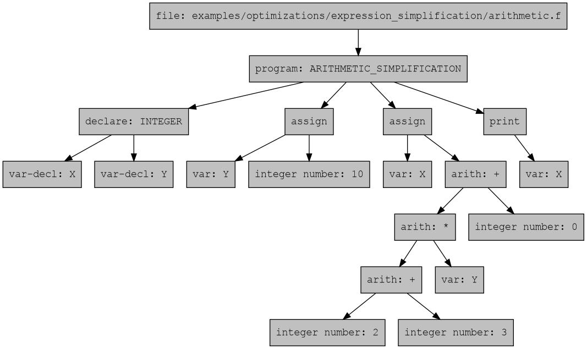
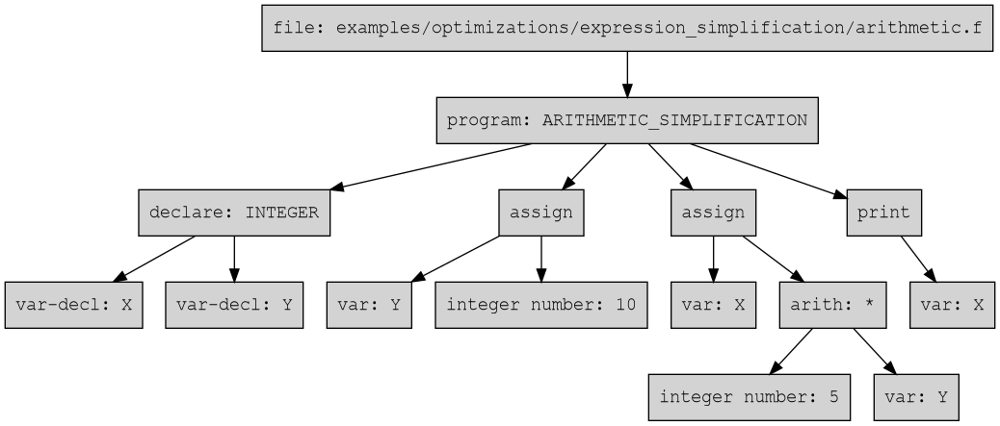
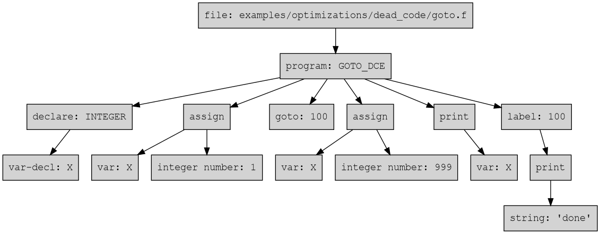
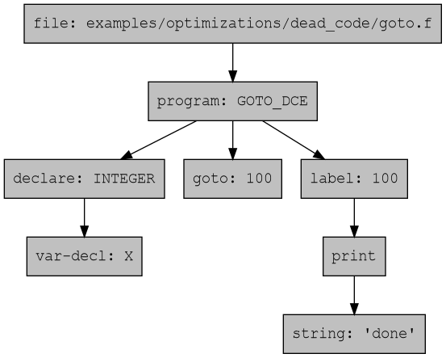

[](https://github.com/migueltc13/project-LP/actions/workflows/tests.yml)

# Language Processing <br/> *Processamento de Linguagens*

This project implements a compiler for a representative subset of
**Fortran 77**, developed for the Language Processing course assignment. The
compiler is written in Python and uses **PLY** for lexical and syntactic
analysis. Its main goal is to translate Fortran 77 source programs into
**EWVM assembly**, while also providing diagnostics, semantic validation,
optional optimizations, and automated tests.

The implementation supports both fixed-format (`.f`) and free-format (`.f90`)
input through a preprocessing stage that normalizes formatting differences
before lexical analysis. The compiler pipeline includes preprocessing, lexical
analysis, syntax analysis, semantic analysis, optional AST-level optimizations,
and EWVM code generation.

The supported language subset includes program units, variable declarations,
assignments, arithmetic and logical expressions, conditional statements,
labelled `DO` loops, labels and `GOTO`, input/output statements, one-dimensional
arrays, subroutines, functions, intrinsic functions, pass-by-reference procedure
arguments, and recursive procedure calls. The compiler also implements several
semantic checks, such as label validation, variable usage checks, type checking,
procedure validation, numeric range checking, and division-by-zero detection.

In addition to the core compiler pipeline, the project includes optimizations
such as constant folding, expression simplification, dead-code elimination, and
simple loop vectorization. A test suite validates valid examples, lexical,
syntax, semantic, and code-generation errors, source-format equivalence, and the
main optimization passes.

## Table of Contents

- [Usage](#usage)
- [Compiler Pipeline Overview](#compiler-pipeline-overview)
- [Preprocessor](#preprocessor)
- [Lexical Analysis](#lexical-analysis)
- [Syntax Analysis](#syntax-analysis)
- [Semantic Analysis](#semantic-analysis)
    - [Program unit checks](#program-unit-checks)
    - [Label checks](#label-checks)
    - [Loop checks](#loop-checks)
    - [Variable checks](#variable-checks)
    - [Reference resolution](#reference-resolution)
    - [Numeric checks](#numeric-checks)
    - [Procedures checks](#procedures-checks)
    - [Type checks](#type-checks)
- [Optimizations](#optimizations)
    - [Constant Folding](#constant-folding)
    - [Expression Simplification](#expression-simplification)
    - [Dead Code Elimination](#dead-code-elimination)
    - [Vectorization](#vectorization)
- [Code Generation](#code-generation)
- [Error Handling](#error-handling)
    - [Supported Diagnostics](#supported-diagnostics)
- [Conclusions and Future Work](#conclusions-and-future-work)
- [Resources](#resources)
    - [Tools](#tools)
    - [Fortran 77 References](#fortran-77-references)

## Usage

```
usage: generator.py [-o OUTPUT] [-O] [-g] [--format {fixed,free}] [--no-preprocess]
                    [--viz [OUTPUT]] [--no-open] [--show-intrinsics] [-v] [-h]
                    [input_file]

Compile Fortran 77 source code into EWVM assembly.

positional arguments:
  input_file            Fortran source file. If omitted, read from stdin.

options:
  -o OUTPUT, --output OUTPUT
                        Output file. If omitted, output to stdout.
  -O, --optimize        Enable optimizations.
  -g, --debug           Enable debug comments.
  --format {fixed,free}
                        The source format. If omitted, inferred from file extension;
                        stdin defaults to fixed.
  --no-preprocess       Skip preprocessing stage.
  --viz [OUTPUT], --visualize [OUTPUT]
                        Generate a Graphviz image of the AST.
  --no-open             Do not open the generated AST visualization file. Only valid
                        with --viz/--visualize.
  --show-intrinsics     Include intrinsic procedures in verbose semantic info output.
                        Requires -v/--verbose.
  -v, --verbose         Enable verbose output during compilation (e.g. print
                        intermediate AST, semantic info, etc.)
  -h, --help            Show this help message and exit.
```

## Compiler Pipeline Overview



## Preprocessor

The compiler pipeline begins with a dedicated **Preprocessor** module. Its
original purpose was to simplify the handling of Fortran 77 fixed-format source
code before lexical analysis. This was necessary because fixed-format Fortran is
highly column-sensitive: columns 1 to 5 may contain a statement label, column 6
is reserved for continuation markers, and the actual statement body begins at
column 7 and may only extend up to column 72.

Handling these rules directly in the lexer would make the lexical analysis
significantly more complex, since the lexer would need to be aware not only of
tokens, but also of their exact column positions. To avoid this, the
preprocessor converts fixed-format input into a normalized pseudo-Fortran
representation that is easier for the lexer to process.

For fixed-format source code, the preprocessor is responsible for:

- enforcing the maximum column width of 72 characters;
- normalizing full-line comments beginning with `C`, `c`, or `*` in column
    into a common `!` comment form;
- extracting labels from columns 1 to 5 and converting them into an explicit
    pseudo-token, such as `@LABEL(100)`;
- validating that labels contain only numeric values with at most five digits;
- detecting continuation lines through column 6, and converting continuation
    markers into a normalized `&` representation by appending `&` to the
    previous statement line;
- detecting invalid continuations, such as a continuation line without a
    preceding statement.

If invalid fixed-format input is detected, the preprocessor raises an explicit
preprocessing error and the compiler pipeline is halted before lexical analysis.
Examples of such errors include lines exceeding 72 columns, invalid labels in
the label field, or orphaned continuation lines.

After the initial implementation, the group realized that the same normalization
strategy could also be applied to free-format source code. Although free-format
does not depend on fixed columns, labels can still appear before statements.
Therefore, the free-format preprocessor also converts labels into the same
`@LABEL(...)` pseudo-token representation. This allows both fixed-format and
free-format programs to be transformed into a common intermediate textual
representation before reaching the lexer.

The result is a single preprocessing stage that supports both source formats and
produces a normalized pseudo-Fortran 77 stream. This reduces the complexity of
the lexer and also the parser, since they no longer need to distinguish between
several surface-level formatting conventions. Instead, they can operate over a
more uniform representation.

However, this approach also introduces an important disadvantage. The
preprocessor inserts pseudo-tokens, such as `@LABEL(...)`, which are not part of
the original Fortran source code. Although this simplifies the lexer and parser,
it creates a challenge for one of the main objectives of the compiler as a
whole: accurate error reporting. Since transformed lines may no longer preserve
the original column positions, errors detected in later stages may refer to
locations in the preprocessed code rather than in the user’s original source
file.

This trade-off was accepted because the problem can be addressed with
source-location mapping. Since the preprocessor preserves a 1:1 mapping
between original and preprocessed lines, the compiler can extend this mapping
with column information. Later stages, such as the lexer, parser, and semantic
analyser, can then translate reported positions back to the original source.
For example, when a line contains an inserted `@LABEL(...)` token, the compiler
can compensate for the introduced offset and report the correct original column.
This allows the compiler to keep the advantages of normalization while still
preserving accurate diagnostics.

Furthermore, although the preprocessor could try to infer the source format
automatically, this was not chosen because fixed-format and free-format code can
be ambiguous. Instead, the compiler uses an explicit CLI flag when provided,
otherwise it infers the format from the file extension: `.f` for fixed-format
and `.f90` for free-format. When reading from standard input without a specified
format, it defaults to fixed-format.

For example:

```fortran
      PROGRAM EXAMPLE
C = 1
      END
```

In fixed-format Fortran, `C = 1` is a comment because `C` appears in column 1.
In free-format Fortran, it may be interpreted as an assignment to variable `C`.
This ambiguity makes explicit or extension-based format selection more
predictable.

The preprocessing stage is additionally validated through the automated test
[formats.py](tests/formats.py), it compares the outputted lexed tokens for
equivalent fixed-format (`.f`) and free-format (`.f90`) source files. When
running the lexer, the `--test` flag is used to remove the column field from
the lexed tokens, since positions naturally differ between the two formats.

## Lexical Analysis

The lexical analysis phase is responsible for transforming the preprocessed
Fortran 77 source code into a stream of tokens that can be consumed by the
parser, using the [PLY (Python Lex-Yacc)](https://www.dabeaz.com/ply/ply.html)
library.

Unlike preprocessing, which handles format normalization and structural cleanup
of fixed and free-format source code, the lexer operates directly on the
normalized pseudo-Fortran representation produced by the preprocessing stage.
At this point, fixed-format constraints have already been resolved, labels have
been converted into `@LABEL(...)` pseudo-tokens, continuation lines symbols have
been normalized, and both source formats share a unified input stream. This
significantly reduces formatting ambiguities and simplifies the complexity
of token recognition.

### Token Categories

The lexer defines a set of tokens grouped into the following categories:

1. **Reserved Keywords**

- **Program Structure:** `PROGRAM`, `END`;
- **I/O Statements:** `READ`, `WRITE`, `PRINT`;
- **Data Types:** `INTEGER`, `REAL`, `DOUBLE`, `LOGICAL`, `CHARACTER`;
- **Control Flow:** `IF`, `THEN`, `ELSE`, `ENDIF`;
- **Iteration and Jumps:** `DO`, `CONTINUE`, `GOTO`, `STOP`;
- **Procedures:** `SUBROUTINE`, `FUNCTION`, `RETURN`.

2. **Identifiers, Literals and Punctuation**

- **Identifiers:** Variable and procedure names;
- **Numeric Literals:** Integer, double precision, and real literals;
- **Strings:** Single or double-quoted strings, with proper handling of escaped
characters;
- **Labels:** Recognized through the preprocessor as `@LABEL(...)` pseudo-tokens.
The lexer converts them into a `LABEL` token containing the numeric identifier.

The lexer also supports a small set of punctuation symbols, such as `( ) , : =`.
These are handled as single-character tokens for simplicity.

3. **Operators**

Instead of defining operators as literals, we used tokens, because they simplify
the attachment of semantic information and precedence rules during later stages
of compilation.
For the `POWER` operator, we had to define it before the `ASTERISK` operator,
otherwise it would be lexed as two separate `ASTERISK` tokens.

- **Math Operators:** `PLUS`, `MINUS`, `DIVIDE`, `POWER`, `ASTERISK`;
- **Dot Relational Operators:** `EQ`, `NE`, `LT`, `LE`, `GT`, `GE`;
- **Logical Dot Operators and Constants:** `AND`, `OR`, `NOT`, `TRUE`, `FALSE`.

Since Fortran 77 is case-insensitive, the lexer converts identifiers,
dot operators, and logical constants to uppercase during tokenization.
This allows the parser and later stages to operate over a uniform
representation independently of the original source casing.

4. **Whitespaces and Comments**

Whitespace characters (space, tab, and the continuation marker `&`) are ignored
by the lexer.

Comments are fully discarded at lexical level:
- Fixed-format comments starting with `C`, `c`, or `*` in column 1;
- Inline comments starting with `!`.

### Handling Lexical Errors

The lexer includes error detection for invalid characters and unsupported
sequences. Any character not matching the defined token rules triggers a
lexical error, and consecutive invalid characters are grouped into a single
diagnostic to improve error message readability.
Errors are reported using the compiler's diagnostic system, including source
line extraction, column position calculation, error length highlighting, and
optional filename tracking.
After reporting, the lexer skips the invalid input and continues analysis,
allowing multiple errors to be detected in a single compilation run.

The lexical analysis stage is additionally validated through an automated test
[lexer.py](tests/lexer.py). This test executes the lexer over all example
source files in test mode, verifying that valid programs are tokenized
successfully. The automated test [errors.py](tests/errors.py) also includes
several cases that trigger lexical errors, which are stored in
[examples/errors/lexical/](examples/errors/lexical/).

## Syntax Analysis

> *The complete set of grammar productions implemented by the parser is*
> *available in [captured_parser_rules.txt](.assets/captured_parser_rules.txt).*
> *This file is automatically generated from the parser source using the script*
> *[capture_parser_rules.py](scripts/capture_parser_rules.py).*


The syntax analysis phase is responsible for recognizing the grammatical
structure of the preprocessed and tokenized Fortran 77 source code. It is
implemented with **PLY Yacc**, using a set of grammar rules distributed across
the main parser module and several smaller rule modules.

Since PLY implements an LALR(1) parsing algorithm, our grammar prioritizes
left recursion. In bottom-up parsers, left-recursive productions are generally
preferred over right-recursive ones because reductions occur earlier, resulting
in lower parser stack usage and a more natural representation of left-associative
operators.

The parser consumes the token stream produced by the lexer and constructs an
**Abstract Syntax Tree (AST)**. Instead of executing semantic actions directly or
generating code during parsing, the compiler represents the program as a tree of
Python objects. Each relevant language construct is represented by a dedicated
AST node, such as `Program`, `Subroutine`, `Function`, `Declare`, `Assign`,
`If`, `Do`, `Call`, `ArrayRef`, arithmetic expressions, relational expressions,
logical expressions, and literal values.

This design makes later compiler stages simpler and more modular. Semantic
analysis, optimizations, visualization, pretty printing, and code generation all
operate over the same AST representation instead of repeatedly analysing the raw
source text or token stream.

To keep the grammar maintainable, the parser rules were split by language
feature. The main parser module defines the start symbol, program unit grammar,
parser state, and command-line flow, while the [parser_rules](src/parser_rules/)
package groups related productions into smaller files:

- [statements.py](src/parser_rules/statements.py): declarations, assignments,
labels, loops, jumps, procedure calls, and control statements;
- [conditionals.py](src/parser_rules/conditionals.py): structured conditional
statements;
- [expressions.py](src/parser_rules/expressions.py): literals, variables, calls,
arithmetic, relational, and logical expressions;
- [io.py](src/parser_rules/io.py): `READ`, `WRITE`, and `PRINT` statements;
- [common.py](src/parser_rules/common.py): shared grammar helpers, such as
optional and repeated lists.

The parser recognizes complete files as a sequence of program units. A file may
contain one main `PROGRAM` unit and several procedure units, namely
`SUBROUTINE`s and typed `FUNCTION`s. Although the parser accepts multiple program
units syntactically, the semantic analysis phase is responsible for rejecting
invalid combinations, such as multiple main programs.

The grammar supports the main statement forms required by the implemented
language subset:

- declarations of scalar variables and one-dimensional arrays;
- assignments to variables and array positions;
- arithmetic, relational, and logical expressions;
- structured `IF ... THEN ... ELSE ... ENDIF` statements;
- labelled `DO` loops;
- labels, `GOTO`, `CONTINUE`, `STOP`, and `RETURN`;
- `READ`, `WRITE`, and `PRINT` statements;
- subroutine calls through `CALL`;
- function calls inside expressions.

For expressions, the grammar is organized by precedence levels, from logical
operators down to primary expressions. This ensures that expressions combining
arithmetic, relational, and logical operators are parsed according to the
intended precedence. Arithmetic operators, relational operators, logical
operators, unary operators, literals, variables, array references, and function
calls are all represented explicitly in the AST.

The parser also records source-location information in AST nodes whenever
possible. This location metadata is used by later stages to produce precise
diagnostics, including line and column information. This is especially important
because some syntax errors are only detected after preprocessing has inserted
pseudo-tokens such as `@LABEL(...)`.

In addition to building the AST, the parser records some lightweight contextual
information needed by semantic analysis. For example, it tracks label
definitions and label references, `DO` loop target labels, and whether a
`RETURN` statement appears in a valid procedure context. The final validation of
these properties is still performed by semantic passes, but collecting this
information during parsing avoids repeated traversal of the raw token stream.

The AST can also be inspected directly through two utility features: a
pretty-printer, which displays the tree in a readable textual form, and a
Graphviz-based visualization mode, which generates a graphical representation of
the parsed program. These tools were useful during development and debugging,
especially when validating grammar rules and later optimization passes.

The automated test [errors.py](tests/errors.py) includes several cases that
trigger syntax errors, which are stored in
[examples/errors/syntax/](examples/errors/syntax/). The syntax analysis stage
is validated through the test [parser.py](tests/parser.py), which verifies that
valid example source files are parsed successfully and that the resulting AST
matches expected structures.

## Semantic Analysis

After syntax analysis, the compiler performs a sequence of semantic checks over
the AST. While the parser verifies whether the input follows the grammar, the
semantic analyser verifies whether the parsed program is meaningful according to
the rules supported by the compiler.

The semantic analysis stage is organized as a set of independent passes. Each
pass is responsible for a specific family of checks, which makes the
implementation easier to understand, test, and extend. The passes are executed
in a fixed order, because some checks depend on information produced by earlier
passes.

The implemented semantic pipeline is:

1. program unit checks;
2. label checks;
3. loop checks;
4. variable checks;
5. reference resolution;
6. numeric checks;
7. procedure checks;
8. type checks.

This separation also allows the compiler to rebuild semantic information after
optimization passes. Since optimizations may replace or remove AST nodes, some
metadata, such as expression types and variable usage information, must be
computed again before code generation.

### Program unit checks

The first semantic pass validates the structure of the file at the program-unit
level. The compiler accepts files containing a main `PROGRAM` unit and additional
procedure units, such as `SUBROUTINE`s and typed `FUNCTION`s.

However, a valid file may contain at most one main program. If more than one
`PROGRAM` unit is found, the compiler reports a semantic error. This rule is not
enforced by the parser because the grammar allows a file to be parsed as a
sequence of program units; deciding whether that sequence is valid is a semantic
responsibility.

### Label checks

Fortran 77 uses numeric labels for statements such as `GOTO` and labelled `DO`
loops. The label checking pass validates the consistency of all labels collected
during parsing.

This pass detects:

- repeated label definitions;
- references to labels that were never defined;
- labels that are defined but never referenced.

Undefined and duplicated labels are reported as errors, while unused labels are
reported as warnings. Labels introduced by the preprocessor through the
`@LABEL(...)` pseudo-token are also handled here, including compensation for the
column offset introduced by that transformation when producing diagnostics.

### Loop checks

The loop checking pass validates labelled `DO` loops. In the supported Fortran
77 subset, a `DO` loop refers to a target label, and that label must identify a
`CONTINUE` statement.

For example, the compiler accepts loops whose target label correctly marks a
`CONTINUE`, but rejects loops where the target label is missing or labels a
different kind of statement.

This pass is separated from the general label checks because a label may exist
and still be invalid as a `DO` loop target. Therefore, loop validation requires
both label information and statement information.

### Variable checks

The variable checking pass builds scope information for every program unit. Each
`PROGRAM`, `SUBROUTINE`, and `FUNCTION` has its own scope containing the
variables declared in that unit.

This pass records:

- declared variables;
- variable types;
- array declarations and dimensions;
- procedure arguments;
- assignments;
- variable uses;
- function return variables.

The compiler implements a strict declaration model: variables must be explicitly
declared before use. This differs from traditional Fortran implicit typing
rules, where variable names may imply types based on their first letter. The
strict model was chosen because it makes the compiler easier to reason about and
allows clearer diagnostics.

The variable pass detects:

- duplicate variable declarations;
- uses of undeclared variables;
- assignments to undeclared variables;
- variables that may be used before being initialized;
- declared variables that are never used.

For functions, the function name is also treated as a special local variable.
Assignments to that name define the function return value, following the common
Fortran convention.

### Reference resolution

During parsing, some syntactic forms are intentionally left ambiguous. In
particular, an identifier followed by parentheses can represent either an array
reference or a function call. The parser cannot always decide this immediately,
because the distinction depends on semantic information.

For example, in a statement such as:

`A(1) = 10`

the syntax alone only shows that `A` is used with parentheses. After variable
analysis, the compiler can check whether `A` was declared as an array. If it was,
the ambiguous node is resolved into an `ArrayRef`. If the name instead refers to
a known function, it is resolved into a `Call`.

This pass replaces parser-level ambiguous nodes with more precise AST nodes.
This is important because later stages, such as type checking and code
generation, should not need to deal with ambiguous references.

Reference resolution also prevents later passes from duplicating the same
decision logic. Once this pass finishes, array accesses and function calls are
represented explicitly and can be handled independently.

### Numeric checks

The numeric checking pass validates constant numeric expressions. This pass was
introduced separately from the type checker because numeric validity is not only
a type compatibility issue; it also depends on the values of constant
expressions.

The pass detects:

- division by a constant zero value;
- integer values outside the supported integer range;
- real values outside the supported real range;
- double precision values outside the supported double range.

This is especially useful because some numeric errors cannot be correctly
detected in the lexer. For instance, the lexer sees numeric literals before the
parser has built unary expressions, so it cannot reliably distinguish an invalid
large positive integer from a valid negative boundary value. By checking numbers
after parsing, the compiler can correctly analyse expressions such as unary
minus and constant arithmetic.

Examples of errors caught by this pass include constant expressions equivalent
to division by zero and numeric literals or folded expressions that exceed the
target range.

### Procedures checks

The procedure checking pass validates user-defined procedures and intrinsic
functions.

For user-defined procedures, it records all `SUBROUTINE` and `FUNCTION`
definitions, verifies that procedure names are unique, and checks that procedure
calls refer to known procedures. It also detects mismatches between how a
procedure is defined and how it is used.

This pass detects:

- duplicate procedure definitions;
- calls to undefined procedures;
- using a `FUNCTION` as a `SUBROUTINE`;
- using a `SUBROUTINE` as a `FUNCTION`;
- wrong number of procedure arguments;
- attempts to redefine an intrinsic function;
- invalid arguments for user-defined pass-by-reference calls.

Intrinsic functions are treated as known procedures during semantic analysis,
but they are not user-defined symbols. Therefore, redefining one of these names
as a user procedure is rejected. Their arity is also checked semantically, for
example ensuring that `SQRT` receives one argument, `MOD` receives two, and
`MAX`/`MIN` receive at least two.

Because user-defined procedures are compiled with pass-by-reference semantics,
actual arguments must be addressable values, such as variables or array
elements. Intrinsic functions are different: they are evaluated as ordinary
expressions and may receive expression arguments.

### Type checks

The final semantic pass performs type inference and type validation. It assigns
a type to each expression and checks whether operators, assignments, conditions,
array accesses, procedure calls, and loop constructs are used consistently.

The supported basic types are:

- `INTEGER`;
- `REAL`;
- `DOUBLE`;
- `LOGICAL`;
- `CHARACTER`.

The type checker validates assignments by comparing the type of the right-hand
side expression with the declared type of the target variable. It allows safe
numeric conversions where supported by the compiler, such as assigning an
`INTEGER` expression to a `REAL` variable, but rejects invalid assignments such
as assigning a string to an integer.

This pass also checks:

- arithmetic operators only receive numeric operands;
- logical operators only receive logical operands;
- relational operands are compatible;
- `IF` conditions are logical;
- array dimensions and indices are integers;
- `DO` loop variables, bounds, and steps are integers;
- `DO` loop steps are positive in the currently supported subset;
- intrinsic function arguments have valid types;
- intrinsic function calls produce the correct return types.

For intrinsic functions, the type checker computes return types according to the
function being called. For example, `INT` returns `INTEGER`, `REAL` and `FLOAT`
return `REAL`, `DBLE` returns `DOUBLE`, `IABS` returns `INTEGER`, `DABS`
returns `DOUBLE`, and `MAX`/`MIN` return the widest numeric type among their
arguments.

The result of this pass is not only used to report semantic errors. It is also
stored as metadata for code generation, allowing the generator to choose the
correct EWVM instructions for integer operations, floating-point operations,
logical operations, conversions, reads, writes, and intrinsic functions.

The semantic analysis stage can be validated, as well, through the automated test
[parser.py](tests/parser.py), which verifies that valid example source
files are parsed successfully and that the resulting AST matches expected
structures.

The automated test [errors.py](tests/errors.py) also includes several cases that
trigger semantic errors, which are stored in
[examples/errors/semantic/](examples/errors/semantic/).

It is also possible to run all aforementioned automated tests, from preprocessing
to parsing, with the script [run-all.sh](tests/run-all.sh). This script executes
all tests in one run for a more quick and seamless testing experience.


## Optimizations

After semantic analysis, the compiler may optionally apply optimization passes
to the AST. Optimizations are enabled through the `-O` command-line flag. When
this flag is not provided, the compiler skips this stage and sends the validated
AST directly to code generation.

The optimizations are implemented as AST-to-AST transformations. Each pass
receives the current AST and returns an equivalent, but potentially simpler or
more efficient, AST. This keeps the optimization stage independent from parsing
and code generation.

The current optimization pipeline is:

1. constant folding;
2. expression simplification;
3. dead-code elimination;
4. vectorization.

After the optimization pipeline finishes, the compiler runs a reduced semantic
analysis pass again. This is necessary because optimizations may replace,
remove, or introduce AST nodes. As a result, metadata computed before
optimization, such as expression types, variable usage information, and resolved
references, may no longer match the transformed tree. Rebuilding semantic
information ensures that code generation receives a consistent AST and matching
semantic metadata.

Example source files demonstrating the optimizations can be found in
[examples/optimizations/](examples/optimizations/).

### Constant Folding

Constant folding evaluates expressions whose result can be computed at compile
time. Instead of generating EWVM instructions to compute these expressions at
runtime, the compiler replaces the expression subtree with a literal value in
the AST.

For example, the expression `2 + 3 * 4` can be evaluated during compilation and
replaced by the integer literal `14`.

Example source program:

```fortran
      PROGRAM ARITHMETIC_CONSTANT_FOLDING
      INTEGER X
      X = 2 + 3 * 4
      PRINT *, X
      END
```

<div align="center">
    <kbd>
    
    <br>
    <sub><strong>Original AST</strong></sub>
    </kbd>
</div>

<br>

<div align="center">
    <kbd>
    
    <br>
    <sub><strong>Optimized AST</strong></sub>
    </kbd>
</div>

<br>

This optimization is applied to arithmetic, relational, logical, and unary
expressions when all operands are compile-time constants. It also supports
constant exponentiation for the power operator. Unsafe cases, such as division
by zero, are not folded. Those are instead reported by the semantic numeric
checks.

Function calls are deliberately not folded, even when their arguments are
constant, because calls may represent user-defined procedures or operations with
side effects. Constant folding for known intrinsic functions is left as future
work.

### Expression Simplification

Expression simplification applies algebraic and logical identities to simplify
expressions without necessarily evaluating them completely.

Examples of supported simplifications include:

- `X + 0` becoming `X`;
- `X - 0` becoming `X`;
- `X * 1` becoming `X`;
- `X / 1` becoming `X`;
- `X * 0` becoming `0` (when `X` is side-effect free);
- `.TRUE. .AND. X` becoming `X`;
- `.FALSE. .OR. X` becoming `X`;
- `.NOT. (.NOT. X)` becoming `X`;
- `+X` becoming `X`.

This pass complements constant folding. Constant folding reduces expressions
made only of literals, while expression simplification can simplify expressions
that still contain variables.

```fortran
      PROGRAM ARITHMETIC_SIMPLIFICATION
      INTEGER X, Y
      Y = 10
      X = (2 + 3) * Y + 0
      PRINT *, X
      END
```

After constant folding, `(2 + 3)` becomes `5`. After expression simplification,
`5 * Y + 0` becomes `5 * Y`.

<div align="center">
    <kbd>
    
    <br>
    <sub><strong>Original AST</strong></sub>
    </kbd>
</div>

<br>

<div align="center">
    <kbd>
    
    <br>
    <sub><strong>Optimized AST</strong></sub>
    </kbd>
</div>

<br>

The pass is conservative around expressions that may contain function calls,
because removing or duplicating such expressions could change program behavior
if the function has side effects.

### Dead Code Elimination

Dead-code elimination removes statements or branches that cannot affect program
execution.

The pass handles several cases:

- statements after unconditional control-flow transfers such as `GOTO`,
    `RETURN`, and `STOP`;
- unreachable `IF` branches when the condition is a compile-time constant;
- assignments to variables whose values are never used afterwards;
- declarations of variables that become unused after other dead code is removed;
- unused procedures when they are not reachable from the main program.

For example, in the following program, the statements between `GOTO 100` and
label `100` are unreachable:

```fortran
      PROGRAM GOTO_DCE
      INTEGER X
      X = 1
      GOTO 100
      X = 999
      PRINT *, X
  100 PRINT *, 'done'
      END
```

<div align="center">
    <kbd>
    
    <br>
    <sub><strong>Original AST</strong></sub>
    </kbd>
</div>

<br>

<div align="center">
    <kbd>
    
    <br>
    <sub><strong>Optimized AST</strong></sub>
    </kbd>
</div>

<br>

The pass also simplifies constant-condition branches. For example, if an `IF`
condition is known to be true at compile time, the compiler keeps only the
then-branch and removes the else-branch.

Dead-code elimination is applied conservatively to preserve observable program
behavior. For instance, `READ` statements are not removed simply because their
target variable appears unused, since reading input changes the program's input
consumption and is therefore observable.

### Vectorization

The vectorization pass performs a simple AST-level loop transformation for a
restricted class of labelled `DO` loops. Its goal is to reduce loop overhead by
expanding several iterations of a loop body into a single loop iteration.

The implemented transformation is conservative. It only applies when the loop
has compile-time integer bounds, a positive step, a simple body, and no unsafe
control-flow interaction. The pass also handles remainder iterations when the
number of loop iterations is not divisible by the selected vector size.

For example, with vector size 4, the following loop:

```fortran
      PROGRAM VECTOR_SUM_REMAINDER
      INTEGER I, SUM
      SUM = 0

      DO 100 I = 1, 10
          SUM = SUM + I
  100 CONTINUE

      PRINT *, SUM
      END
```

can be transformed into a loop that processes four additions per iteration,
followed by extra statements for the remaining iterations.

Conceptually, the loop is transformed from:

```fortran
      DO 100 I = 1, 10
          SUM = SUM + I
  100 CONTINUE
```

into a form similar to:

```fortran
      DO 100 I = 1, 5, 4
          SUM = SUM + I
          SUM = SUM + I + 1
          SUM = SUM + I + 2
          SUM = SUM + I + 3
  100 CONTINUE

      SUM = SUM + I
      SUM = SUM + I + 1
```

The generated AST preserves the original program result while reducing the
number of loop-control iterations.

Because this optimization rewrites loop bodies and may introduce new
expressions, the compiler rebuilds semantic metadata after optimization before
code generation.

Examples:

Example file                                                                | AST before optimization                                                            | AST after optimization
---                                                                         | ---                                                                                | ---
[basic_sum.f](examples/optimizations/vectorization/basic_sum.f)             | [basic_sum.png](.assets/optimizations/vectorization/png/basic_sum.png)             | [basic_sum_optimized.png](.assets/optimizations/vectorization/png/basic_sum_optimized.png)
[sum_remainder.f](examples/optimizations/vectorization/sum_remainder.f)     | [sum_remainder.png](.assets/optimizations/vectorization/png/sum_remainder.png)     | [sum_remainder_optimized.png](.assets/optimizations/vectorization/png/sum_remainder_optimized.png)
[vector_stride_2.f](examples/optimizations/vectorization/vector_stride_2.f) | [vector_stride_2.png](.assets/optimizations/vectorization/png/vector_stride_2.png) | [vector_stride_2_optimized.png](.assets/optimizations/vectorization/png/vector_stride_2_optimized.png)

## Code Generation

The final stage of the compiler translates the semantically validated AST into
**EWVM assembly**. Code generation is performed after parsing, semantic analysis,
and, optionally, optimization. At this point, the compiler has access not only to
the AST, but also to semantic metadata such as variable scopes, expression types,
procedure information, resolved references, and array declarations.

The generator follows a direct AST-to-EWVM strategy. Each AST node is visited and
translated into one or more EWVM instructions. Statement nodes generate control
flow and side effects, while expression nodes leave their resulting value on the
EWVM stack.

The code generation stage is responsible for:

- allocating global and local storage;
- generating code for assignments, expressions, input/output, conditionals, and
  loops;
- translating scalar variables and one-dimensional arrays;
- generating subroutine and function calls;
- implementing pass-by-reference procedure arguments;
- supporting recursive procedures through local stack frames;
- generating code for supported intrinsic functions;
- selecting integer or floating-point EWVM instructions based on semantic type
  information.

Example source files used for testing code generation can be found in
[examples/](examples/), with additional files for recursive procedures in
[examples/recursion/](examples/recursion/), intrinsic functions in
[examples/intrinsics/](examples/intrinsics/), and pass-by-reference procedure
arguments in [examples/reference/](examples/reference/).

For the automated test [errors.py](tests/errors.py), some examples of code
generation errors were developed, which are stored in
[examples/errors/code_gen/](examples/errors/code_gen/).

### Memory Layout

The generator separates storage into two categories: **global slots** and
**local slots**.

Variables declared in the main `PROGRAM` are allocated in global memory. These
are accessed through EWVM global instructions such as `PUSHG` and `STOREG`.

Variables declared inside `SUBROUTINE`s and `FUNCTION`s are allocated in the
procedure's local stack frame. These are accessed through frame-relative
instructions such as `PUSHL` and `STOREL`. This distinction is essential for
recursion: each procedure call receives its own local frame, so local variables
from different recursive invocations do not overwrite each other.

The generator also reserves a small number of compiler temporaries per scope.
These temporary slots are used to store intermediate values when direct stack
evaluation would be unsafe, for example when an expression contains a recursive
function call or when an intrinsic function requires temporary storage. This
approach keeps the code generator simple while still preserving recursion-safe
execution.

### Expressions

Expressions are generated recursively. Literal nodes push their values directly
onto the EWVM stack, variables load their current value, and compound
expressions generate code for their operands followed by the corresponding EWVM
operation.

For arithmetic expressions, the generator uses the expression type information
computed during semantic analysis to decide whether to emit integer or
floating-point instructions. For example, integer addition uses `ADD`, while
floating-point addition uses `FADD`.

The same principle is used for relational and logical expressions. Relational
operators emit comparison instructions such as `INF`, `INFEQ`, `SUP`, `SUPEQ`,
or their floating-point equivalents. Logical expressions use boolean EWVM
operations such as `AND`, `OR`, and `NOT`.

Special care is taken when expressions contain user-defined function calls.
Since EWVM procedure calls manipulate the runtime stack, the generator avoids
leaving important intermediate values on the stack across a call. Instead, it
stores function-call results or pending operands in compiler temporary slots and
then restores the expected evaluation order. This is necessary for expressions
such as recursive factorial computations, where a function call appears inside a
larger arithmetic expression.

### Statements and Control Flow

Assignments generate code for the right-hand side expression and then store the
result into the target variable or array position. If the assignment target is a
formal procedure argument, the generator writes through the reference address
received by the procedure.

Conditional statements are compiled using labels and conditional jumps. The
condition expression is generated first, leaving a boolean value on the stack.
The generator then emits `JZ` instructions to branch to the `ELSE` or end label
when the condition is false.

Labelled `DO` loops are translated using explicit EWVM labels and jumps. The
loop variable is initialized, compared against the upper bound, and incremented
at the labelled `CONTINUE` statement. The current implementation supports
positive integer loop steps.

Input and output statements are also translated directly. `PRINT` and `WRITE`
evaluate each item and then select the appropriate EWVM output instruction based
on the expression type. `READ` reads a value, converts it to the target type,
and stores it in a variable or array element.

### Arrays

The compiler supports one-dimensional arrays. Array variables store the base
address of a heap-allocated block. During code generation, array declarations
emit allocation instructions, and array accesses compute a zero-based offset
from the Fortran-style one-based index.

An array read loads the array base address, computes the index offset, and emits
an indexed load. An array assignment similarly computes the target address and
stores the generated value into the selected position.

Array arguments are passed by reference. When an array is passed to a procedure,
the callee receives the base address of the caller's array instead of receiving
a copy. This allows procedures to modify arrays directly.

The current implementation is limited to one-dimensional arrays.
Multidimensional arrays are left as future work.

### Procedures and Pass-by-Reference

User-defined procedures are compiled as EWVM labelled blocks. Each `SUBROUTINE`
or `FUNCTION` receives a generated label, and calls are emitted using `PUSHA`
followed by `CALL`.

Procedure arguments are passed by reference. Instead of copying argument values
into the callee, the caller pushes the address of each actual argument onto the
stack. The callee then accesses those addresses through negative frame offsets
relative to the current frame pointer.

This means a subroutine such as one that increments its argument can modify the
caller variable directly. The same mechanism also supports passing array
elements and complete arrays by reference.

Because procedure arguments are references, semantic analysis requires
user-defined procedure arguments to be addressable expressions, such as
variables or array elements. Intrinsic functions are different: they are
evaluated as ordinary expressions and may receive non-addressable expression
arguments.

### Recursive Procedures

Recursion is supported by using EWVM local stack frames for procedure-local
variables. Every time a function or subroutine is called, EWVM creates a new
call frame. Local variables and compiler temporaries are allocated inside that
frame, which prevents recursive calls from overwriting the state of previous
invocations.

Function calls use a hidden result address. The caller provides an address where
the function should store its result. The callee assigns to its function-name
variable during execution and, before returning, copies that value into the
hidden result address. This keeps function return values recursion-safe without
requiring a global return slot.

For example, a recursive factorial function can safely call itself because each
invocation has its own local variables, temporaries, argument references, and
return destination.

### Intrinsic Functions

The compiler supports a selected set of intrinsic functions:

`ABS`, `IABS`, `DABS`, `POW`, `SQRT`, `DSQRT`, `EXP`, `DEXP`, `INT`, `REAL`,
`DBLE`, `FLOAT`, `MAX`, `MIN`, and `MOD`.

These functions are recognized during semantic analysis and generated directly
as EWVM code. Simple intrinsics, such as conversions and `MOD`, map directly to
existing EWVM instructions. Other intrinsics are implemented with generated
instruction sequences.

The `ABS`, `MAX`, and `MIN` intrinsics use comparisons and conditional jumps.
The `POW` intrinsic and the `**` operator are implemented through a loop for
integer exponents. `SQRT` is implemented using Newton's method with a fixed
number of iterations. `EXP` is approximated using a Taylor series expansion with
a fixed number of terms.

As an example, `EXP` is generated directly in EWVM using a truncated Taylor
series expansion. The mathematical definition is:

$$
e^x = \sum_{n=0}^{\infty} \frac{x^n}{n!}
$$

The compiler approximates this infinite sum with a fixed number of terms:

$$
e^x \approx \sum_{n=0}^{12} \frac{x^n}{n!}
$$

This avoids depending on an external math library while still demonstrating how
more complex intrinsic functions can be lowered into ordinary EWVM arithmetic,
compiler temporaries, and loops.

Similarly, `SQRT` is implemented using Newton's method, repeatedly applying:

$$
x_{k+1} = \frac{1}{2}\left(x_k + \frac{N}{x_k}\right)
$$

where `N` is the input value and `x_k` is the current approximation.

Intrinsic implementations use compiler temporary slots rather than global
temporary variables. This is important because intrinsic calls may appear inside
recursive functions, and global temporaries would make recursive execution
unsafe.

### Limitations

The code generator supports the main constructs required by the implemented
Fortran 77 subset, but some limitations remain:

- only one-dimensional arrays are supported;
- fixed-length `CHARACTER` arrays are not supported;
- negative `DO` loop steps are not fully supported;
- dynamic array dimensions inside procedures are not supported;
- intrinsic functions are generated with simple implementations rather than
  full mathematical library precision;
- compiler temporary allocation uses a fixed number of temporary slots per
  scope;
- array bounds checks are not currently emitted.

Despite these limitations, the generator supports the central features of the
project: complete program translation to EWVM assembly, typed expression
generation, arrays, procedure calls, pass-by-reference arguments, recursion,
intrinsic functions, and optimized AST input.

## Error Handling

The compiler includes a shared diagnostic system used by the preprocessor,
lexer, parser, semantic analyser, and code generator. Instead of each stage
printing errors independently, diagnostics are collected in a common format and
reported consistently to the user.

Each diagnostic may include:

- the source filename;
- the line and column where the issue was detected;
- the original source line;
- a highlighted span pointing to the problematic region;
- a severity level, such as error or warning;
- an optional hint explaining how the issue may be fixed.

This design makes error reporting independent from the compiler stage that
detected the problem. For example, a syntax error, an undeclared variable, and a
type mismatch can all be displayed using the same user-facing format.

The compiler attempts to continue after recoverable errors when possible. This
allows multiple diagnostics to be reported in a single run instead of stopping
after the first problem. However, later compilation stages are skipped when
errors are present. For example, code generation is not attempted if lexical,
syntax, or semantic errors were detected.

Warnings are also supported. Unlike errors, warnings do not necessarily prevent
compilation. They are used for issues such as unused labels, unused variables,
or variables that may be used before being initialized.

### Supported Diagnostics

Severity                            | Type         | Category     | Description                                                         | Hint
:--                                 | :--          | :--          | :--                                                                 | :-:
$\color{Red}\textsf{Error}$         | Preprocessor | Format       | Line exceeds 72 columns                                             |
$\color{Red}\textsf{Error}$         | Preprocessor | Continuation | Orphaned continuation line                                          |
$\color{Red}\textsf{Error}$         | Preprocessor | Labels       | Label field contains non-numeric characters                         |
$\color{Red}\textsf{Error}$         | Lexical      |              | Character not valid                                                 | <span title="Remove this character or replace it with valid Fortran 77 syntax">✓</span>
$\color{Red}\textsf{Error}$         | Lexical      |              | Character sequence not valid                                        | <span title="Remove these characters or replace them with valid Fortran 77 syntax">✓</span>
$\color{Red}\textsf{Error}$         | Syntax       |              | Syntax error in token                                               |
$\color{Red}\textsf{Error}$         | Syntax       |              | Unexpected end of file                                              | <span title="Perhaps you forgot the END statement">✓</span>
$\color{Red}\textsf{Error}$         | Semantic     | Program      | Multiple main PROGRAM units defined                                 | <span title="Keep only one main PROGRAM unit">✓</span>
$\color{Red}\textsf{Error}$         | Semantic     | Labels       | Label redefined                                                     |
$\color{Red}\textsf{Error}$         | Semantic     | Labels       | Label referenced but not defined                                    |
$\color{Goldenrod}\textsf{Warning}$ | Semantic     | Labels       | Label defined but not referenced                                    |
$\color{Red}\textsf{Error}$         | Semantic     | Loops        | DO loop target label does not label a CONTINUE statement            |
$\color{Red}\textsf{Error}$         | Semantic     | Variables    | Variable already declared                                           |
$\color{Red}\textsf{Error}$         | Semantic     | Variables    | Use of undeclared variable                                          |
$\color{Red}\textsf{Error}$         | Semantic     | Variables    | Assignment to undeclared variable                                   |
$\color{Goldenrod}\textsf{Warning}$ | Semantic     | Variables    | Variable may be used before being initialized                       |
$\color{Goldenrod}\textsf{Warning}$ | Semantic     | Variables    | Variable declared but not used                                      |
$\color{Red}\textsf{Error}$         | Semantic     | Procedures   | Undefined procedure reference                                       | <span title="Perhaps you meant {sugestions}">✓</span>
$\color{Red}\textsf{Error}$         | Semantic     | Procedures   | Duplicate procedure definition                                      |
$\color{Red}\textsf{Error}$         | Semantic     | Procedures   | Procedure definition conflicts with intrinsic procedure             | <span title="Choose a different procedure name; intrinsic procedure names are reserved">✓</span>
$\color{Red}\textsf{Error}$         | Semantic     | Procedures   | FUNCTION called as a SUBROUTINE                                     | <span title="Use function calls in expressions, and subroutines with CALL">✓</span>
$\color{Red}\textsf{Error}$         | Semantic     | Procedures   | SUBROUTINE called as a FUNCTION                                     | <span title="Use CALL for subroutines, and function calls inside expressions">✓</span>
$\color{Red}\textsf{Error}$         | Semantic     | Procedures   | Procedure mismatched expected number of arguments                   |
$\color{Red}\textsf{Error}$         | Semantic     | Procedures   | RETURN statement outside procedure                                  |
$\color{Red}\textsf{Error}$         | Semantic     | Numeric      | Division by zero                                                    |
$\color{Red}\textsf{Error}$         | Semantic     | Numeric      | INTEGER value out of range                                          | <span title="Integer values must be between -2,147,483,648 and 2,147,483,647">✓</span>
$\color{Red}\textsf{Error}$         | Semantic     | Numeric      | REAL value out of range                                             | <span title="Real values must be representable in the target REAL range">✓</span>
$\color{Red}\textsf{Error}$         | Semantic     | Numeric      | DOUBLE value out of range                                           | <span title="Double values must be representable in the target DOUBLE range">✓</span>
$\color{Red}\textsf{Error}$         | Semantic     | Types        | IF condition must be of type LOGICAL                                |
$\color{Red}\textsf{Error}$         | Semantic     | Types        | Array dimension must be of type INTEGER                             |
$\color{Red}\textsf{Error}$         | Semantic     | Types        | Array index must be of type INTEGER                                 |
$\color{Red}\textsf{Error}$         | Semantic     | Types        | Cannot assign value of type X to type Y variable                    |
$\color{Red}\textsf{Error}$         | Semantic     | Types        | DO loop variable must be of type INTEGER                            |
$\color{Red}\textsf{Error}$         | Semantic     | Types        | DO loop upper/lower bound must be of type INTEGER                   |
$\color{Red}\textsf{Error}$         | Semantic     | Types        | DO loop step must be of type INTEGER                                |
$\color{Red}\textsf{Error}$         | Semantic     | Types        | DO loop step must be a positive INTEGER                             |
$\color{Red}\textsf{Error}$         | Semantic     | Types        | Unary operators ('+' and '-') require numeric operand               |
$\color{Red}\textsf{Error}$         | Semantic     | Types        | NOT requires a LOGICAL operand                                      |
$\color{Red}\textsf{Error}$         | Semantic     | Types        | Left/right arithmetic operand must be numeric                       |
$\color{Red}\textsf{Error}$         | Semantic     | Types        | Relational operands must have compatible types                      |
$\color{Red}\textsf{Error}$         | Semantic     | Types        | Left/right logical operand must be LOGICAL                          |
$\color{Red}\textsf{Error}$         | Code Gen     | Arrays       | Only one-dimensional arrays are supported yet                       |
$\color{Red}\textsf{Error}$         | Code Gen     | Arrays       | Only one-dimensional array references/assignments are supported yet |
$\color{Red}\textsf{Error}$         | Code Gen     | Arrays       | Dynamic array dimensions inside procedures are not supported yet    |
$\color{Red}\textsf{Error}$         | Code Gen     | Program      | Code generation requires a PROGRAM unit                             |
$\color{Red}\textsf{Error}$         | Code Gen     | Statements   | Unsupported statement for EWVM generation                           |
$\color{Red}\textsf{Error}$         | Code Gen     | Expressions  | Unsupported expression for EWVM generation                          |
$\color{Red}\textsf{Error}$         | Code Gen     | Assignments  | Unsupported assignment target                                       |
$\color{Red}\textsf{Error}$         | Code Gen     | Instructions | Unsupported READ target                                             |
$\color{Red}\textsf{Error}$         | Code Gen     | Instructions | Only one-dimensional array READ is supported yet                    |
$\color{Red}\textsf{Error}$         | Code Gen     | Operators    | Unsupported arithmetic/relational/logical/unary operator            |
$\color{Red}\textsf{Error}$         | Code Gen     | Procedures   | Not a FUNCTION/SUBROUTINE                                           |

> *Hover over the hint check marks (✓) in the table above to see sample hint messages.*

<!--
HTML:
<span style="background:#ffecec;color:#b00020;padding:2px 6px;border-radius:4px;font-weight:bold;">Error</span>
<span style="background:#fff8db;color:#8a6d00;padding:2px 6px;border-radius:4px;font-weight:bold;">Warning</span>
<span style="color:green">✓</span>
<span style="color:red">✗</span>

LaTeX:
$\color{Goldenrod}\textsf{Warning}$
$\color{Red}\textsf{Error}$
$\color{Green}\textsf{✓}$
$\color{Red}\textsf{✗}$
-->

### Diagnostic Example

A typical diagnostic includes the error message, source location, highlighted
source line, and an optional hint. For example, an invalid procedure call may be
reported as:

```
error: unknown function 'SQRTT'
  --> examples/test.f:3:5
  |
4 | 3 = SQRTT(9.0)
  |     ^^^^^
  = hint: perhaps you meant 'SQRT' or 'DSQRT'

1 error(s)/warning(s) encountered.
```

<!--
Program used for this example:

```fortran
      PROGRAM TEST
      INTEGER A
      A = SQRTT(9.0)
      PRINT *, A
      END
```
-->

This format was chosen to make compiler errors easier to understand and closer
to the diagnostics produced by modern compilers. The highlighted span helps the
user quickly identify the relevant part of the source program, while hints are
used when the compiler can provide a likely correction.

Some diagnostics require special handling because the source code is transformed
before parsing. For instance, fixed-format labels are converted by the
preprocessor into pseudo-tokens such as `@LABEL(...)`. When later stages report
errors involving these labels, the compiler compensates for the inserted text so
that diagnostics still refer to the user's original source positions.

## Conclusions and Future Work

The final result goes beyond a minimal parser by implementing several aspects
usually expected from a small compiler: precise diagnostics, scoped semantic
analysis, AST transformations, procedure handling, recursion-safe code
generation, and automated validation through tests. The most important design
choice was to keep the compiler modular, allowing each phase to remain focused
on a specific responsibility while still sharing a common AST and semantic
metadata.

The main limitations are well isolated and provide clear directions for future
work:

- support multidimensional arrays;
- implement negative-step `DO` loops;
- add runtime array bounds checks using EWVM `CHECK`;
- improve compiler temporary allocation for deeply nested expressions instead
  of relying on a fixed number of temporary slots per scope;
- add constant folding for known intrinsic function calls;
- improve mathematical precision for generated `SQRT` and `EXP`;
- extend the supported Fortran 77 grammar with more statement forms and
  standard-library features, (e.g. implicit typing, etc.);
- combine some semantic passes for efficiency once the implementation is stable.

Overall, the project demonstrates a complete and extensible compiler
architecture. The remaining work is mostly incremental, focused on supporting a
larger language subset and refining the generated code.

## Resources

### Tools

- [PLY (Python Lex-Yacc)](https://www.dabeaz.com/ply/ply.html)
- [EWVM](https://ewvm.epl.di.uminho.pt/)
- [GraphViz](https://graphviz.org/)
- [GFortran](https://gcc.gnu.org/wiki/GFortran)
- [GitHub Actions](https://github.com/features/actions)

### Fortran 77 References

- [Fortran 77 Reference Language Manual, Innsbruck](http://physik.uibk.ac.at/hephy/praktikum/fortran_manual.pdf)
- [Fortran 77 Reference Language, Oracle](https://docs.oracle.com/cd/E19957-01/805-4939/)
- [Fortran 77 Standard Fixed Format, Oracle](https://docs.oracle.com/cd/E19957-01/805-4939/z40007331fe6/index.html)
- [Fortran 77, Wikipedia](https://en.wikipedia.org/wiki/Fortran_77)

<a href="https://www.youtube.com/watch?v=4XF_Agllu7Q" target="_blank">🥚</a>
