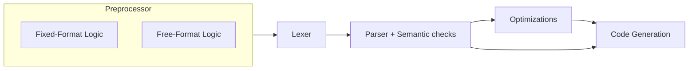

# Language Processing   *Processamento de Linguagens*

## Resources

- [EWVM](https://ewvm.epl.di.uminho.pt/)
- [FORTRAN 77 Reference Language | Oracle](https://docs.oracle.com/cd/E19957-01/805-4939/)
- [FORTRAN 77 Reference Language Manual | Innsbruck](http://physik.uibk.ac.at/hephy/praktikum/fortran_manual.pdf)
- [FORTRAN 77 | Wikipedia](https://en.wikipedia.org/wiki/Fortran_77)
- [FORTRAN 77 Standard Fixed Format | Oracle](https://docs.oracle.com/cd/E19957-01/805-4939/z40007331fe6/index.html)

## TODO list

- [ ] Sort errors by line/column/length and severity, then if so,
      remove label-related errors sorting
- [ ] Merge example 7_comments.f with 9_strings.f (and respective .f90)
- [ ] Optional step counter (example: `2`) in do_statement (example: `DO 100 I = 1, 10, 2`)
- [ ] Optimizations
    - [ ] Constant folding
    - [ ] Expression simplification
    - [ ] Unused variable elimination
    - [ ] Constant `IF` elimination
    - [ ] Loop unrolling
- [ ] Add support for the functions defined in INTRINSIC_FUNCTIONS at [procedures.py](src/semantics/procedures.py)
      From the lexer to the parser and then to the code generation.
      Also see `# TODO remove intrinsics that we don't support` at the same file.
- [ ] `semantics/numbers.py`
    - [ ] Detect division by zero and other similar errors
    - [ ] Out of range errors are detected in the lexer, but they are not complete
          (e.g. MINUS NUMBER, etc.) we could add a semantic check for this after the
          parsing, also adjust values for EWVM compatibility
- [x] Variables (unused warning, redefinition, etc.)
- [x] Write equivalent .f90 (free-format) at examples/
- [x] (parser) check for special statements like RETURN, CONTINUE, STOP,
      are being only recognized in the right contexts
      (e.g. RETURN only inside subroutines/functions, etc.)
- [x] test labels errors (e.g. redefinition, use of undefined labels,
      warning for unused labels)
- [ ] NOTE in report that strict version was implemented instead of implicit typing rules

## Compiler Pipeline

## Preprocessing

## Lexical Analysis

## Syntax Analysis

## Semantic Analysis

## Code Generation

## Code Optimization

- Unused variable elimination
- Constant `IF` elimination
- Loop unrolling
